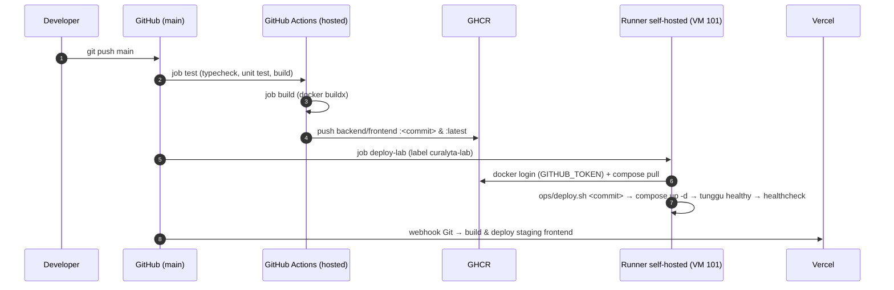

# Arsitektur Curalyta

Semua nama, alamat IP, dan port di dokumen ini adalah resource yang benar-benar dibuat (lihat `docs/DEPLOYMENT.md` dan `docs/bukti/`).

## 1. Topologi cloud dan jaringan

```mermaid
flowchart TB
  user([Pengguna / browser]):::ext
  admin([Admin - laptop Windows<br/>192.168.45.1]):::ext

  subgraph PUBLIC["Public cloud (SaaS / PaaS)"]
    cf["Cloudflare edge<br/>HTTPS *.trycloudflare.com"]
    vercel["Vercel - staging frontend (PaaS)"]
    gh["GitHub<br/>repo + Actions + Secrets"]
    ghcr[("GHCR<br/>ghcr.io/muhammadabrarrayhan2/curalyta/{backend,frontend}")]
    groq["Groq API (AI)<br/>rotasi multi-key"]
    ntfy["ntfy.sh<br/>push + email alert"]
  end

  subgraph HOST["Laptop: Windows 11 + VMware Workstation 17.6 (Hyper-V off, VT-x nested)"]
    subgraph NAT["VMware NAT vmnet8 - 192.168.45.0/24, gateway/DNS .2"]
      subgraph PVE["Proxmox VE 9.2 - pve.curalyta.lab 192.168.45.10 (KVM)"]
        fw{{"Proxmox Firewall<br/>default DROP per VM"}}
        bridge["Bridge vmbr0"]
        lvm[("local-lvm<br/>block storage (LVM-thin)")]
        dump[("local: /var/lib/vz/dump<br/>vzdump harian, retensi 7")]

        subgraph APP["VM 101 curalyta-app - 192.168.45.20 (Ubuntu 22.04, 2 vCPU, 2,5 GB)"]
          tunnel["cloudflared<br/>curalyta-tunnel.service"]
          nginx["nginx :80<br/>reverse proxy"]
          fe["frontend :8080<br/>(non-root)"]
          be["backend :4000<br/>Express + Prisma"]
          pg[("postgres 16<br/>vol curalyta_postgres_data")]
          runner["GitHub runner<br/>label curalyta-lab"]
          agents["node_exporter :9100<br/>cAdvisor :8080"]
          cron["cron 02:00<br/>backup-db.sh"]
        end

        subgraph MON["VM 102 curalyta-monitor - 192.168.45.30 (Ubuntu 22.04, 2 vCPU, 1,5 GB)"]
          prom["Prometheus :9090"]
          am["Alertmanager :9093"]
          graf["Grafana :3000"]
          bb["Blackbox Exporter"]
          garage[("Garage S3 :3900<br/>bucket curalyta-db-backups<br/>lifecycle 30 hari")]
        end
      end
    end
  end

  user -->|HTTPS| cf
  user -->|HTTPS| vercel
  cf <-->|tunnel keluar| tunnel
  tunnel --> nginx
  vercel -->|rewrite /api| cf
  nginx -->|/| fe
  nginx -->|/api, /health| be
  be --> pg
  be -->|HTTPS| groq
  cron -->|pg_dump → S3 API (rclone)| garage
  admin -->|SSH key / :8006| PVE
  admin -->|:3000 :9090 :9093 :3900| MON
  fw -.melindungi.- APP
  fw -.melindungi.- MON
  APP --- bridge
  MON --- bridge
  APP -.disk.-> lvm
  MON -.disk.-> lvm
  PVE -->|vzdump| dump
  prom -->|scrape| agents
  prom -->|probe| bb
  bb -->|HTTP /health| nginx
  bb -->|HTTPS /health| cf
  prom --> am --> ntfy
  graf --> prom

  classDef ext fill:#eef,stroke:#669
```

## 2. Alur CI/CD



## 3. Alur permintaan pengguna

1. Browser membuka URL HTTPS publik (Cloudflare edge). TLS diterminasi di edge.
2. Cloudflare meneruskan permintaan melalui tunnel yang dibuka dari dalam VM aplikasi (tidak ada port masuk yang dibuka di laptop atau router).
3. `cloudflared` meneruskan ke `nginx:80` di VM yang sama.
4. Nginx merutekan `/` ke container `frontend` (file statis React) dan `/api/*` serta `/health` ke `backend`.
5. Backend memvalidasi JWT, menjalankan logika aplikasi, membaca/menulis PostgreSQL melalui Prisma, dan untuk fitur AI memanggil Groq API.
6. Nginx mencatat setiap permintaan dalam log JSON (`request_time`, `upstream_response_time`).

## 4. Alur data backup dan pemulihan

| Lapisan | Mekanisme | Jadwal | Retensi | Lokasi |
|---|---|---|---|---|
| Database (logis) | `ops/backup-db.sh`: `pg_dump -Fc` + SHA-256 → Garage (rclone) | Harian 02:00 WIB | 7 file lokal; 30 hari di bucket (lifecycle) | VM 101 `/var/backups/curalyta` → VM 102 bucket `curalyta-db-backups` |
| VM (image penuh) | vzdump mode snapshot, kompresi zstd | Harian 01:30 WIB | 7 harian | `pve:/var/lib/vz/dump` |
| Snapshot VM | `qm snapshot` sebelum perubahan berisiko | Sesuai kebutuhan | Dihapus setelah perubahan terverifikasi | `local-lvm` |
| Image aplikasi | GHCR tag per commit | Setiap push | Tak terbatas | GitHub |
| Konfigurasi | Git | Setiap commit | Riwayat penuh | GitHub |

## 5. Pemetaan ke arsitektur materi pelatihan

| Materi (slide) | Implementasi Curalyta |
|---|---|
| Arsitektur dasar cloud: Physical → Virtualization → Management → Service → Consumer (6) | Laptop → VMware/Proxmox KVM → Proxmox (provisioning, firewall, backup) + Prometheus → IaaS/PaaS/SaaS → pengguna |
| Topologi: User → Router/Firewall → Switch/Virtual bridge → Host virtualisasi → VM aplikasi/VM database (12) | Browser → Cloudflare + Proxmox Firewall → `vmbr0` → `pve` → VM `curalyta-app` (aplikasi + PostgreSQL) dan `curalyta-monitor` |
| REST API: Browser → HTTP → Node.js + Express → PostgreSQL → JSON (15) | Sama persis (bagian 3) |
| Praktik terintegrasi: Windows + VMware → Proxmox → Ubuntu VM PostgreSQL + Node.js → Monitoring VM Prometheus + Grafana (32) | Sama persis |
| Prometheus + Grafana + Blackbox (27) | `ops/lab/monitor/` |
