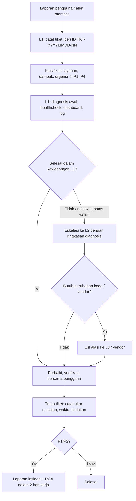

# SOP Dukungan Teknis Curalyta

**Unit kompetensi:** J.631120.015.01 — Memberikan dukungan teknis atas masalah user dan report next layer
**Berlaku untuk:** layanan produksi lab (`curalyta-app`, 192.168.45.20 dan URL HTTPS publik) serta staging Vercel

## 1. Peran dan kanal

| Level | Peran | Kewenangan | Contoh tindakan |
|---|---|---|---|
| **L1** — Helpdesk | Menerima laporan pengguna, first level support | Membaca dashboard dan log, menjalankan `ops/healthcheck.sh`, restart container, membantu pengguna (reset sesi, panduan) | `docker compose restart backend`, memeriksa status di Grafana |
| **L2** — Operator infrastruktur | Admin VM dan Proxmox | Restore backup, rollback deploy, menambah kapasitas VM, memperbarui sertifikat/tunnel, mengubah firewall | `ops/deploy.sh <tag-lama>`, `ops/restore-db.sh`, `qm set 101 --memory ...` |
| **L3** — Pengembang / vendor | Tim aplikasi, penyedia eksternal (Groq, Vercel, GitHub, Cloudflare) | Perbaikan kode, perubahan skema database, eskalasi ke vendor | Patch kode + rilis lewat CI/CD, tiket ke status page vendor |

Kanal laporan pengguna: email helpdesk atau formulir tiket (template di bagian 7). Alert otomatis masuk lewat ntfy.sh (push + email ke `abrarrayhan8@gmail.com`).

## 2. Klasifikasi prioritas

Prioritas ditentukan dari **dampak** (berapa banyak pengguna/fungsi terdampak) dan **urgensi** (seberapa cepat dampaknya membesar).

| Prioritas | Kriteria | Contoh di Curalyta | Respons awal | Target penyelesaian |
|---|---|---|---|---|
| **P1 — Critical** | Layanan utama berhenti untuk semua pengguna | `/health` gagal, situs tidak bisa dibuka, database down | 15 menit | 1 jam (sesuai RTO) |
| **P2 — High** | Fungsi utama terganggu, ada jalan pintas terbatas | Login gagal untuk sebagian pengguna, respons > 1 detik terus-menerus, AI dokter tidak merespons | 30 menit | 4 jam |
| **P3 — Medium** | Dampak terbatas pada sebagian kecil fungsi | Unggah dokumen gagal untuk format tertentu, berita kesehatan tidak muncul | 4 jam | 2 hari kerja |
| **P4 — Low** | Gangguan kecil atau permintaan informasi | Salah ketik di tampilan, pertanyaan cara pakai | 1 hari kerja | Sesuai jadwal rilis |

Alert Prometheus sudah membawa label prioritas: `LayananTidakTersedia` = P1, `WaktuResponsLambat`/`CPUTinggi`/`MemoriTinggi`/`DiskHampirPenuh`/`BackupDatabaseTerlambat` = P2.

## 3. Alur penanganan tiket



Langkah rinci:

1. **Penerimaan.** Catat pelapor, waktu, layanan, gejala, langkah reproduksi, dan screenshot. Beri ID tiket.
2. **Klasifikasi.** Tentukan prioritas memakai tabel bagian 2. Konfirmasi ke pelapor bahwa tiket diterima beserta target respons.
3. **Diagnosis.** Kumpulkan fakta sebelum mengubah apa pun:
   ```bash
   ssh -i ~/.ssh/curalyta_lab curalyta@192.168.45.20
   /opt/curalyta/ops/healthcheck.sh               # endpoint, container, disk
   cd /opt/curalyta && docker compose ps
   docker compose logs --since 30m backend | tail -100
   docker compose logs --since 30m nginx | tail -50   # status & request_time
   ```
   Lalu buka dashboard Grafana **Curalyta — SLA & Infrastruktur** (http://192.168.45.30:3000).
4. **Penyelesaian.** Terapkan perbaikan sesuai panduan di bagian 4. Setiap perubahan produksi dicatat di tiket (apa, kapan, siapa).
5. **Verifikasi.** Jalankan ulang `healthcheck.sh`, cek dashboard hijau, minta pelapor mencoba lagi.
6. **Penutupan.** Isi akar masalah, tindakan, dan durasi. Untuk P1/P2 buat laporan insiden (template bagian 8).

## 4. Panduan troubleshooting masalah umum

### 4.1 Pengguna tidak bisa login

| Langkah | Perintah / tindakan | Interpretasi |
|---|---|---|
| 1 | Minta pesan error persis dan waktu kejadian | "Email atau password salah" = kredensial; "Terlalu banyak percobaan" = rate limit |
| 2 | `docker compose logs --since 1h nginx \| grep /api/auth/login` | Status 401 = kredensial salah; 429 = rate limit; 5xx = masalah server |
| 3 | `curl -s http://localhost/health` | Jika database `down`, tangani sebagai P1 (4.4) |
| 4 | Rate limit (429) | Tunggu 15 menit, atau L2 me-restart backend untuk mereset penghitung |
| 5 | Akun dokter belum diverifikasi | Admin membuka menu Verifikasi dokter di dashboard admin |
| Eskalasi | Banyak pengguna gagal dengan 5xx | Naikkan ke L2 sebagai P1/P2 |

### 4.2 Aplikasi tidak bisa diakses

1. Cek dari luar: `curl -sS -o /dev/null -w '%{http_code} %{time_total}\n' https://<url-publik>/health`.
2. Jika jalur publik gagal tetapi `http://192.168.45.20/health` sehat, masalahnya di tunnel: `sudo systemctl status curalyta-tunnel`, lalu `sudo systemctl restart curalyta-tunnel` dan perbarui URL (`ops/lab/update-public-url.sh`).
3. Jika jalur internal juga gagal: `docker compose ps`. Container yang `exited`/`unhealthy` dinyalakan dengan `docker compose up -d`.
4. Jika VM tidak merespons ping: di Proxmox `qm status 101`, lalu `qm start 101`.
5. Jika host Proxmox mati: nyalakan VM `curalyta-pve` di VMware Workstation (L2).

### 4.3 Aplikasi lambat

1. Lihat panel **Latensi uptime check** dan **CPU/Memori** di Grafana.
2. `docker stats --no-stream` di VM aplikasi untuk menemukan container yang boros.
3. Log Nginx berformat JSON: cari permintaan dengan `request_time` besar:
   `docker compose logs --since 30m nginx | grep -o '"uri":"[^"]*","status":[0-9]*,"bytes_sent":[0-9]*,"request_time":[0-9.]*' | sort -t: -k5 -nr | head`
4. Jika CPU/RAM VM jenuh: L2 menambah kapasitas (`qm set 101 --memory 4096`, reboot terjadwal) sesuai `docs/KEBUTUHAN_PERANGKAT_KERAS.md`.
5. Jika lambat hanya di fitur AI: cek status Groq; key dirotasi otomatis. Eskalasi ke L3 bila semua key terkena limit.

### 4.4 Error database

1. `curl -s http://localhost/health` → `database.status`.
2. `docker compose ps postgres` dan `docker compose logs --since 30m postgres`.
3. Disk penuh menyebabkan PostgreSQL berhenti: lihat 4.6.
4. Container mati: `docker compose up -d postgres`, tunggu `healthy`, lalu `docker compose restart backend`.
5. Data rusak/terhapus: L2 menjalankan `ops/restore-db.sh` (uji ke database `curalyta_restore_test` dulu, lalu `--production`). Catat RPO aktual (umur backup terakhir).

### 4.5 Sertifikat HTTPS kedaluwarsa / bermasalah

Jalur publik lab memakai Cloudflare Tunnel: sertifikat TLS dikelola dan diperbarui otomatis oleh Cloudflare di edge, sehingga tidak ada sertifikat yang perlu diperpanjang di VM.
1. Jika browser menampilkan error sertifikat atau URL tidak ditemukan: URL quick tunnel berubah setelah service restart. Ambil URL baru: `cat /opt/curalyta/.public-url`, lalu jalankan `ops/lab/update-public-url.sh`.
2. Jika memakai sertifikat Let's Encrypt (domain sendiri, `NGINX_SITE=https`): `sudo certbot certificates`, perpanjang dengan `sudo certbot renew`, lalu `docker compose exec nginx nginx -s reload`.

### 4.6 Disk penuh

1. `df -h` dan `docker system df` di VM.
2. Bersihkan aman: `docker image prune -af --filter until=168h`, `sudo journalctl --vacuum-time=7d`, hapus dump lokal lama di `/var/backups/curalyta` (salinan tetap di object storage Garage).
3. Jangan menghapus volume `curalyta_postgres_data`.
4. Jika tetap > 80%: L2 memperbesar disk `qm resize 101 scsi0 +10G`, lalu di VM `sudo growpart /dev/sda 1 && sudo resize2fs /dev/sda1`.

## 5. Matriks eskalasi

| Kondisi | Dari | Ke | Batas waktu sebelum eskalasi |
|---|---|---|---|
| P1 belum pulih | L1 | L2 | 15 menit sejak tiket dibuat |
| P1 belum pulih | L2 | L3 | 45 menit (agar RTO 1 jam masih tercapai) |
| P2 belum ada solusi | L1 | L2 | 1 jam |
| P2 butuh perubahan kode | L2 | L3 | Segera setelah diketahui |
| Butuh restore data produksi | L1 | L2 | Segera (L1 tidak berwenang) |
| Gangguan layanan vendor (Groq, Vercel, GitHub, Cloudflare) | L2 | L3 → vendor | Setelah dipastikan bukan masalah internal |
| Dugaan insiden keamanan (akses tidak sah, kebocoran secret) | Siapa pun | L2 + L3 | Segera; rotasi secret (`docs/SOP_OPERASIONAL.md`) |

Isi minimal saat eskalasi: ID tiket, prioritas, gejala, waktu mulai, langkah diagnosis yang sudah dilakukan beserta hasilnya, dugaan penyebab, dan tindakan yang belum dicoba.

## 6. Komunikasi

| Prioritas | Pembaruan ke pelapor/pengguna |
|---|---|
| P1 | Setiap 30 menit sampai pulih, lalu pemberitahuan pemulihan |
| P2 | Setiap 2 jam |
| P3/P4 | Saat ada perubahan status |

## 7. Template tiket

```markdown
## Tiket TKT-YYYYMMDD-NN
- Pelapor / kontak     :
- Waktu laporan        : YYYY-MM-DD HH:MM WIB
- Layanan              : Produksi lab / Staging Vercel / API AI / Lainnya
- Prioritas            : P1 / P2 / P3 / P4   (alasan: dampak ..., urgensi ...)
- Gejala               :
- Langkah reproduksi   :
- Lampiran             : screenshot / log
- Ditangani oleh       : L1 (nama)
- Diagnosis            :
- Tindakan             :
- Eskalasi             : Tidak / Ya ke L2|L3 pada HH:MM, alasan
- Status               : Baru / Dalam penanganan / Menunggu / Selesai
- Waktu respons awal   :
- Waktu selesai        :
- Akar masalah         :
- Verifikasi pengguna  : Ya / Tidak
```

## 8. Template laporan insiden

```markdown
# Laporan Insiden INC-NNN — <judul singkat>

| Atribut | Nilai |
|---|---|
| Prioritas | P1/P2 |
| Layanan terdampak | |
| Mulai | YYYY-MM-DD HH:MM:SS WIB |
| Terdeteksi | (oleh alert/pengguna) |
| Pulih | |
| Durasi dampak | |
| Penanggung jawab | |

## Ringkasan
## Dampak
## Timeline (deteksi, diagnosis, eskalasi, pemulihan, verifikasi)
## Akar masalah
## Tindakan pemulihan
## Pengaruh terhadap SLA
## Tindakan pencegahan (pemilik, tenggat)
## Bukti (log, screenshot, alert)
```

Contoh pengisian nyata: `docs/LAPORAN_INSIDEN_001.md`.
